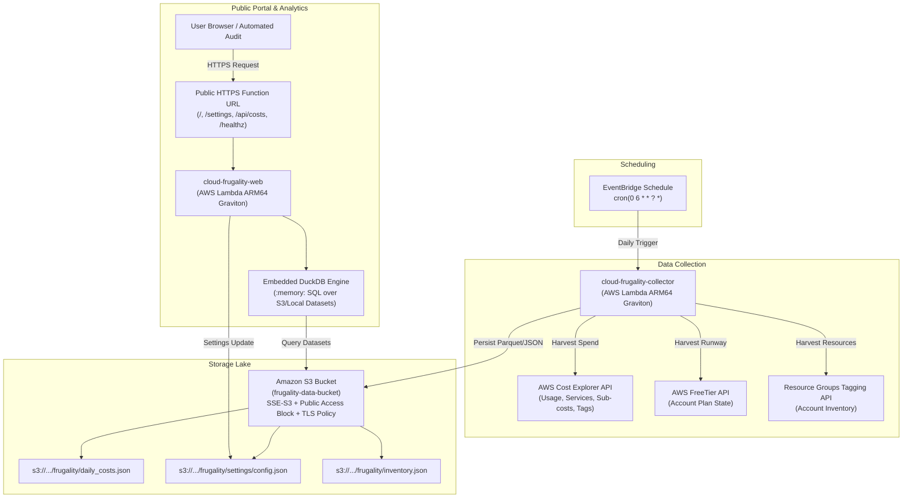
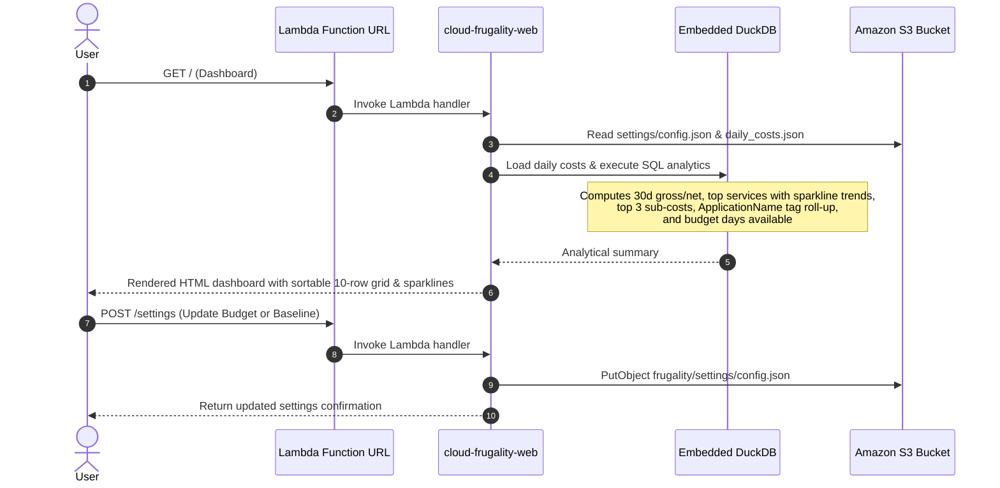

# Cloud Frugality Architecture

## 1. System Overview

Cloud Frugality is a dedicated, serverless AWS cost, promotional credit runway, and active resource tracking microservice designed for maximum operational efficiency, zero specification drift, and near-zero infrastructure operating costs.

### Architectural Evolution: Aurora PostgreSQL to Amazon S3 + DuckDB

Previously, Cloud Frugality relied on an Amazon Aurora Serverless v2 PostgreSQL cluster. While Aurora provided relational capabilities and IAM Database Authentication, it introduced:
- Constant baseline idle costs (~$0.12/hour for 0.5 ACU minimum, or ~$90/month minimum even when idle).
- Cold resume latencies (several seconds when resuming from 0 to 0.5 ACU).
- Complex VPC networking, subnets, and RDS IAM DB auth token generation overhead.

In this architecture, Cloud Frugality transitions to **Amazon S3 + DuckDB**:
- **Zero Idle Cost**: Amazon S3 charges purely for storage ($0.023/GB/month) and requests. Data for a small organization costs pennies per year.
- **Embedded Analytics**: DuckDB executes directly inside the AWS Lambda runtime memory space. Queries over daily costs, 30-day roll-ups, service trends, and tag distributions execute in under **5 milliseconds**.
- **No VPC Bottlenecks**: Functions execute in standard AWS Lambda environments without requiring VPC attachment, private subnets, or NAT Gateways.
- **Stateless & Scalable**: S3 serves as the durable columnar data lake, while DuckDB delivers SQL query capabilities.

---

## 2. Component Diagram

---

## 3. Data Flow & Execution Sequence

---

## 4. Operational Boundaries & Infrastructure as Code

- **Pulumi AWS Provider**: Replaced CDK/Terraform with Pulumi Python (`infra/`). Declaratively manages S3 buckets, granular IAM policies, Lambda functions, log groups, and EventBridge rules.
- **Local AWS Emulation**: Integrates with the local `aws-emulator` binary (AWS Emulator Nov 2026 release) on `https://127.0.0.1:9297`, enabling 100% offline verification with zero cloud costs.
- **Tag Governance**: Every infrastructure component is tagged with `Frugality: true` and audited automatically.
